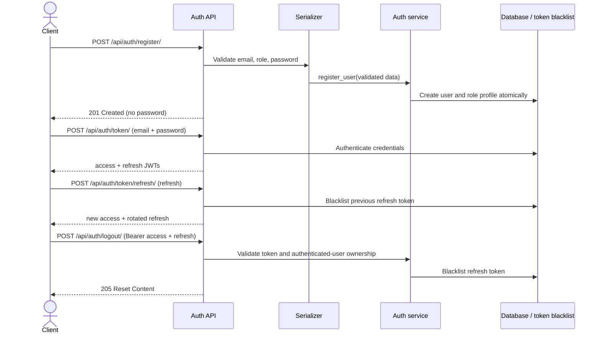

# Day 15 – Authentication Stabilization and Review

## Scope and implementation

Authentication operations are separated from HTTP handling in
`apps/accounts/services.py`. Registration creates the user and its
signal-generated profile inside one database transaction. Logout delegates
refresh-token parsing, ownership validation, and blacklisting to the service;
the API view translates service errors into the existing field-error response.
Role-specific profile creation remains in the `User` post-save signal.

### Module responsibilities

| Component | Responsibility |
|---|---|
| `apps/accounts/serializers.py` | Validate public registration input and invoke registration service. |
| `apps/accounts/services.py` | Atomically create users and validate/blacklist logout refresh tokens. |
| `apps/accounts/tokens.py` | Add email and role claims when issuing a token pair. |
| `apps/accounts/auth_views.py` | Authenticate logout requests and map service errors to API validation errors. |
| `apps/accounts/permissions.py` | Reusable role and profile-owner/admin authorization. |
| `apps/accounts/signals.py` | Create the role-appropriate profile when a user is saved. |
| `apps/accounts/upload_validators.py` | Validate resume size, extension, content type, and basic file structure. |
| `apps/accounts/profile_views.py` | Enforce profile ownership and serve resume files as authenticated downloads. |
| `config/settings.py` | Configure JWT lifetimes/rotation, authentication defaults, and signing-key validation. |

### Authentication endpoint contract

All paths below are relative to `/api/`. JSON error responses use the common
envelope documented in the project README.

| Method and path | Authentication | Request | Success |
|---|---|---|---|
| `POST auth/register/` | Public | `email`, `role`, `password`; optional `phone` | `201`; user fields without password |
| `POST auth/token/` | Public | `email`, `password` | `200`; `access`, `refresh` |
| `POST auth/token/refresh/` | Refresh token | `refresh` | `200`; rotated `access` and `refresh` |
| `POST auth/logout/` | Access token | Matching `refresh` | `205`; empty response |

Invalid registration input returns `400`. Invalid credentials, expired or
blacklisted refresh tokens return `401` on login/refresh as applicable.
Logout returns `400` for malformed, expired, or mismatched refresh tokens and
requires the matching authenticated account.

### Profile and resume endpoint contract

| Method and path | Access | Behavior |
|---|---|---|
| `GET/POST/PUT/PATCH/DELETE profiles/candidate/` | Candidate owner or admin | Read/create-or-reactivate/update/soft-delete candidate profile |
| `GET/POST/PUT/PATCH/DELETE profiles/employer/` | Employer owner or admin | Read/create-or-reactivate/update/soft-delete employer profile |
| `GET/POST/PUT/PATCH/DELETE profiles/{candidate,employer}/<user_id>/` | Admin | Same operations for the selected user's role profile |
| `GET profiles/candidate/resume/` | Candidate owner | Download resume as an attachment |
| `POST/PUT profiles/candidate/resume/` | Candidate owner | Upload or replace resume using multipart field `resume` |
| `DELETE profiles/candidate/resume/` | Candidate owner | Remove resume without deleting profile |
| `GET/POST/PUT/DELETE profiles/candidate/<user_id>/resume/` | Admin | Download, upload/replace, or remove that candidate's resume |

Resume uploads accept PDF, DOC, or DOCX files up to 5 MiB. Successful upload
returns a `download_url`; download responses use `application/octet-stream`,
attachment disposition, and `X-Content-Type-Options: nosniff`. A missing
profile or resume returns `404`; forbidden owner access returns `403`.

### Configuration and operational requirements

| Setting | Requirement / default |
|---|---|
| `SECRET_KEY` | Required; at least 32 characters and not an example placeholder. Keep in a secret store, not source control. |
| `DEBUG` | Defaults to `False`; must remain `False` in production. |
| `ALLOWED_HOSTS` | Comma-separated hostnames; set explicitly for deployment. |
| Access-token lifetime | Five minutes. |
| Refresh-token lifetime | One day; rotation and blacklist-after-rotation enabled. |
| `MEDIA_ROOT` | Local development storage; production media must be private. |
| Blacklist cleanup | Run `python manage.py flushexpiredtokens` regularly. |

Use HTTPS in production and protect tokens in client storage. Logging out
blacklists refresh tokens but cannot revoke an already-issued access token;
that token remains valid until its short expiration.

The configured Django signing key is now required at startup, must be at least
32 characters, and cannot use the known example placeholders. Set
`SECRET_KEY` through the deployment secret store or local `.env`; do not commit
real secrets.

The security review also identified that any employer could mutate any task.
Employer update/delete queries are now scoped to the authenticated creator;
administrators retain access to all tasks. Reads remain available to every
authenticated role. Legacy tasks without a creator can be mutated only by an
administrator. Cross-owner operations return `404` to avoid confirming that
another user's task exists.

## Authentication flow



## API usage guide

All examples use JSON except resume uploads. Replace the sample credentials
and tokens with values from your environment.

### Register

`POST /api/auth/register/`

```json
{
  "email": "candidate@example.com",
  "role": "candidate",
  "password": "use-a-unique-strong-password"
}
```

Choose `candidate` or `employer`; public registration cannot create admins.
The response is `201 Created` and does not include the password. A role profile
is created with the account.

### Log in

`POST /api/auth/token/`

```json
{
  "email": "candidate@example.com",
  "password": "use-a-unique-strong-password"
}
```

The `200 OK` response contains `access` and `refresh` tokens. Use the access
token on protected requests:

```http
Authorization: Bearer <access-token>
```

The access token includes the user's identifier, email, and role. Use the
database-backed authenticated user for authorization decisions.

### Refresh

`POST /api/auth/token/refresh/`

```json
{
  "refresh": "<refresh-token>"
}
```

Refresh tokens rotate on use. Store the returned refresh token and discard the
previous one; replaying the previous token is rejected. Access tokens expire
after five minutes and refresh tokens after one day.

### Log out

`POST /api/auth/logout/` requires both the current access token in the
`Authorization` header and its matching refresh token in the request body:

```json
{
  "refresh": "<refresh-token>"
}
```

The response is `205 Reset Content`. Logout blacklists the matching refresh
token; an already-issued access token remains usable until its short expiry.
Schedule `python manage.py flushexpiredtokens` to prune expired blacklist rows.

### Access summary

| Resource/action | Candidate | Employer | Admin |
|---|---:|---:|---:|
| Register as a public user | Yes | Yes | No |
| Use own candidate/employer profile | Own role only | Own role only | Any |
| Read tasks | Yes | Yes | Yes |
| Create tasks | No | Yes | Yes |
| Update/delete tasks | No | Own tasks | Any task |
| Read or download a resume | Own profile | No | Any candidate |

Unauthenticated requests may access registration, login, and token refresh.
Profile, resume, task-list, and logout requests require authentication.
Task and profile permissions are enforced server-side.

## Security review feedback

The review covered access/refresh expiry and rotation, logout ownership and
blacklisting, profile authorization, and resume upload/storage/download
controls. It reported no exploitable issue in those reviewed authentication
and resume flows. It identified these findings:

| Severity | Finding | Resolution |
|---|---|---|
| High | A known fallback signing key could be used if deployment configuration omitted `SECRET_KEY`. | Fixed: startup now requires a sufficiently long, non-placeholder key. |
| Medium | Employers could update or delete tasks created by other employers. | Fixed: mutations are scoped to the creator; admins retain unrestricted access. |

Resume uploads are limited to PDF/DOC/DOCX and 5 MB, have extension/content
checks, use generated storage names, and are served only through authenticated
attachment responses. These checks reduce risk but do not replace malware
scanning. Production should keep media storage private.

## Architecture discussion and improvement plan

The current boundary is intentionally small: serializers validate transport
input, API views handle HTTP responses and permissions, services own
registration/token operations, and the user signal provisions role profiles.
One decision for review is whether role-profile creation should eventually be
made explicit in the registration service instead of a post-save signal. The
current signal remains transactionally coupled to registration.

Recommended mentor discussion and follow-up:

1. Confirm the ownership policy for shared task reads and creator-only writes,
   including how to handle legacy records with no creator.
2. Select the production secret manager and a key-rotation procedure; the
   signing key must be shared consistently across application instances.
3. Decide the release plan for email verification and login rate limiting.
4. Choose private production file storage and add malware scanning before
   resumes are distributed.
5. Revisit tenant-level task visibility if tasks should not be readable by all
   authenticated users.

No live mentor session or mentor-authored feedback was available during this
implementation. This section is a review brief and improvement plan, not a
claim that a mentor meeting has already occurred.

## Verification

The complete Django test suite passed: 55 tests. `ruff check .` and
`git diff --check` also passed. Deployment still needs production-specific
HTTPS, host, database, and storage settings.
